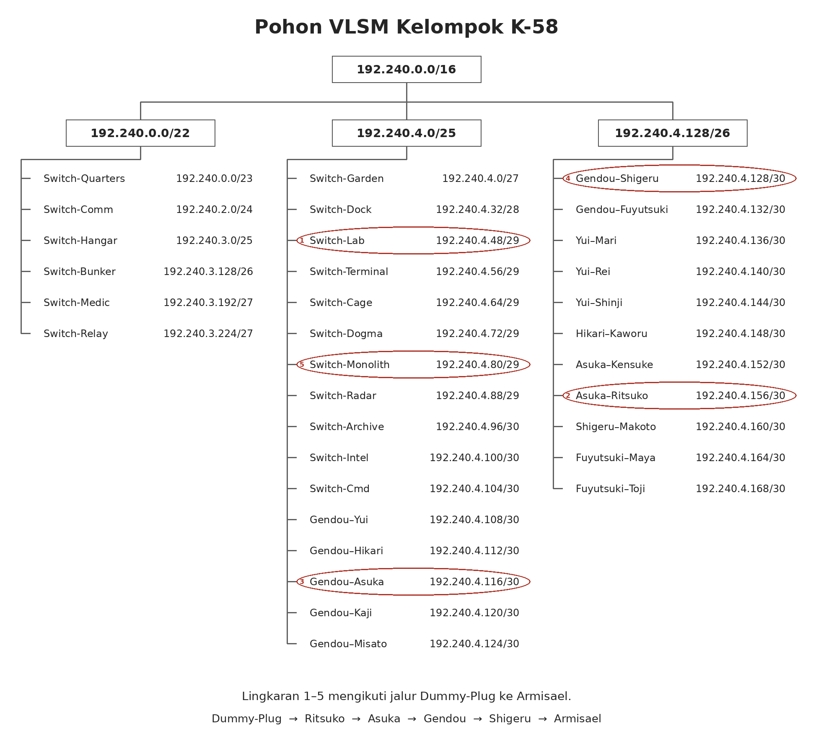
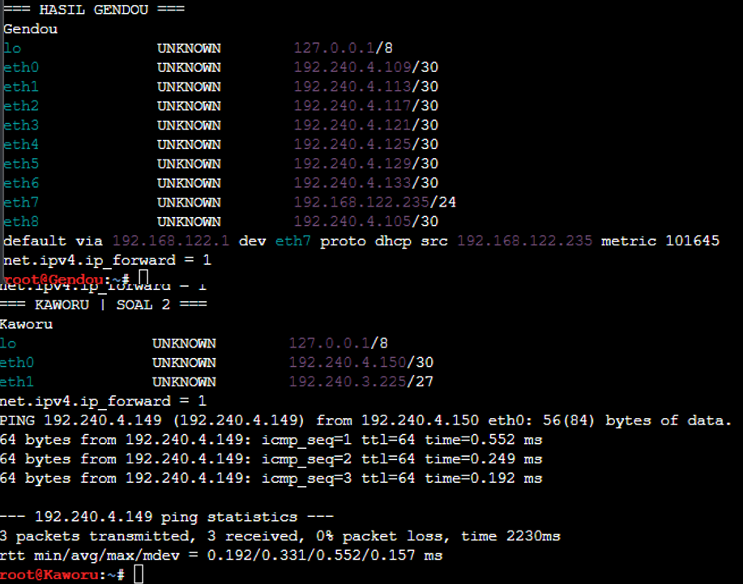
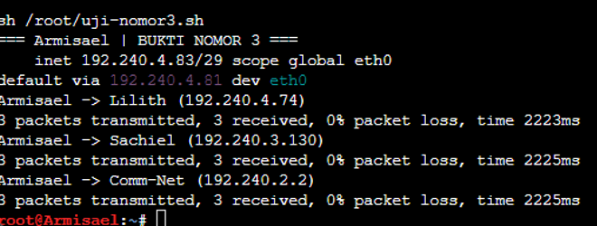
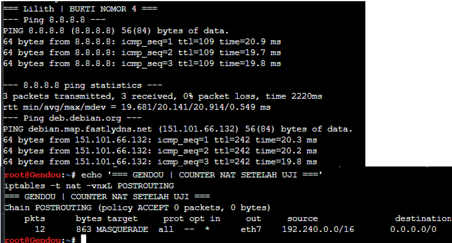
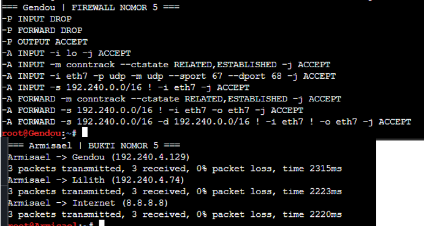
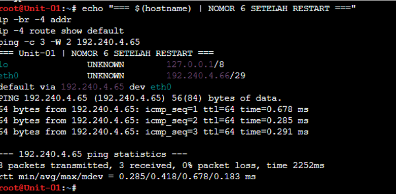
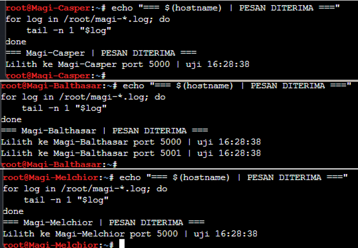
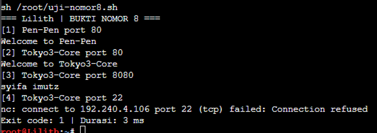
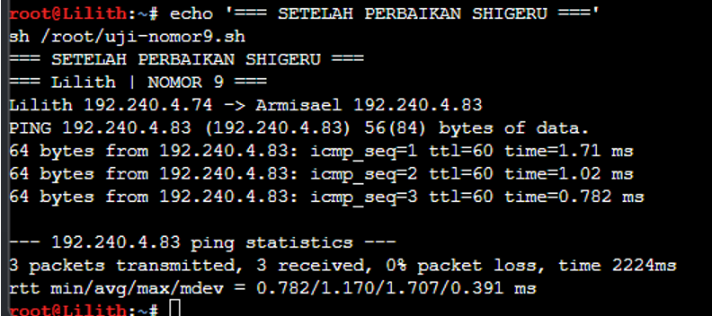
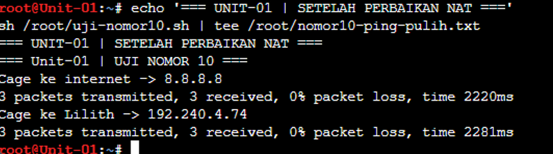

# Laporan Praktikum Modul 5 Jaringan Komputer

**Kelompok K-58 · Operation Geofront · Soal 1–10**

Jaringan Geofront terdiri dari 17 router yang masing-masing melayani satu LAN. Antar-router terdapat 16 link. Gendou menjadi satu-satunya router yang terhubung ke NAT1. Praktikum menggunakan GNS3 dengan blok alamat internal `192.240.0.0/16`.

## Soal 1 · Pembagian alamat dengan VLSM

Setiap container mewakili sekelompok host. Untuk menentukan prefix LAN, jumlah host pada switch dijumlahkan dengan satu alamat gateway. Alokasi dimulai dari subnet terbesar. Jika ukurannya sama, LAN mendapat alokasi lebih dahulu, kemudian link antar-router. Pada setiap LAN, alamat usable pertama dipakai gateway.

**Contoh perhitungan Switch-Quarters.** Quarters membutuhkan 500 alamat host dan satu alamat untuk router Rei, sehingga totalnya 501 alamat usable. Prefix `/24` hanya menyediakan 254 alamat usable. Dengan `/23`, ada 9 bit host sehingga tersedia **2⁹ − 2 = 510 alamat usable**. Dari 510 alamat tersebut, tersisa **9**. Network-nya `192.240.0.0/23`, gateway-nya `192.240.0.1`, dan broadcast-nya `192.240.1.255`.

### Alokasi 17 LAN

| Subnet | Network | Prefix | Gateway | Broadcast | IP terpakai | Sisa usable |
| --- | --- | --- | --- | --- | --- | --- |
| Switch-Quarters | 192.240.0.0 | /23 | 192.240.0.1 | 192.240.1.255 | 501 | 9 |
| Switch-Comm | 192.240.2.0 | /24 | 192.240.2.1 | 192.240.2.255 | 201 | 53 |
| Switch-Hangar | 192.240.3.0 | /25 | 192.240.3.1 | 192.240.3.127 | 101 | 25 |
| Switch-Bunker | 192.240.3.128 | /26 | 192.240.3.129 | 192.240.3.191 | 56 | 6 |
| Switch-Medic | 192.240.3.192 | /27 | 192.240.3.193 | 192.240.3.223 | 27 | 3 |
| Switch-Relay | 192.240.3.224 | /27 | 192.240.3.225 | 192.240.3.255 | 26 | 4 |
| Switch-Garden | 192.240.4.0 | /27 | 192.240.4.1 | 192.240.4.31 | 15 | 15 |
| Switch-Dock | 192.240.4.32 | /28 | 192.240.4.33 | 192.240.4.47 | 13 | 1 |
| Switch-Lab | 192.240.4.48 | /29 | 192.240.4.49 | 192.240.4.55 | 6 | 0 |
| Switch-Terminal | 192.240.4.56 | /29 | 192.240.4.57 | 192.240.4.63 | 4 | 2 |
| Switch-Cage | 192.240.4.64 | /29 | 192.240.4.65 | 192.240.4.71 | 4 | 2 |
| Switch-Dogma | 192.240.4.72 | /29 | 192.240.4.73 | 192.240.4.79 | 3 | 3 |
| Switch-Monolith | 192.240.4.80 | /29 | 192.240.4.81 | 192.240.4.87 | 3 | 3 |
| Switch-Radar | 192.240.4.88 | /29 | 192.240.4.89 | 192.240.4.95 | 5 | 1 |
| Switch-Archive | 192.240.4.96 | /30 | 192.240.4.97 | 192.240.4.99 | 2 | 0 |
| Switch-Intel | 192.240.4.100 | /30 | 192.240.4.101 | 192.240.4.103 | 2 | 0 |
| Switch-Cmd | 192.240.4.104 | /30 | 192.240.4.105 | 192.240.4.107 | 2 | 0 |

### Alokasi 16 link antar-router

Setiap link menggunakan `/30`. Dua alamat usable dipakai oleh kedua interface router. Karena link ini menghubungkan dua router secara langsung, kolom gateway di tabel diberi tanda pisah.

| Subnet | Network | Prefix | Gateway | Broadcast | IP terpakai | Sisa usable |
| --- | --- | --- | --- | --- | --- | --- |
| Gendou–Yui | 192.240.4.108 | /30 | — | 192.240.4.111 | 2 | 0 |
| Gendou–Hikari | 192.240.4.112 | /30 | — | 192.240.4.115 | 2 | 0 |
| Gendou–Asuka | 192.240.4.116 | /30 | — | 192.240.4.119 | 2 | 0 |
| Gendou–Kaji | 192.240.4.120 | /30 | — | 192.240.4.123 | 2 | 0 |
| Gendou–Misato | 192.240.4.124 | /30 | — | 192.240.4.127 | 2 | 0 |
| Gendou–Shigeru | 192.240.4.128 | /30 | — | 192.240.4.131 | 2 | 0 |
| Gendou–Fuyutsuki | 192.240.4.132 | /30 | — | 192.240.4.135 | 2 | 0 |
| Yui–Mari | 192.240.4.136 | /30 | — | 192.240.4.139 | 2 | 0 |
| Yui–Rei | 192.240.4.140 | /30 | — | 192.240.4.143 | 2 | 0 |
| Yui–Shinji | 192.240.4.144 | /30 | — | 192.240.4.147 | 2 | 0 |
| Hikari–Kaworu | 192.240.4.148 | /30 | — | 192.240.4.151 | 2 | 0 |
| Asuka–Kensuke | 192.240.4.152 | /30 | — | 192.240.4.155 | 2 | 0 |
| Asuka–Ritsuko | 192.240.4.156 | /30 | — | 192.240.4.159 | 2 | 0 |
| Shigeru–Makoto | 192.240.4.160 | /30 | — | 192.240.4.163 | 2 | 0 |
| Fuyutsuki–Maya | 192.240.4.164 | /30 | — | 192.240.4.167 | 2 | 0 |
| Fuyutsuki–Toji | 192.240.4.168 | /30 | — | 192.240.4.171 | 2 | 0 |

### Pohon pembagian IP



Nomor pada lingkaran menunjukkan urutan yang dilewati paket. Dummy-Plug (`192.240.4.51`) dan Armisael (`192.240.4.83`) berada pada LAN yang berbeda.

| Urutan | Subnet yang dilewati | Network/prefix |
| --- | --- | --- |
| 1 | Switch-Lab · Dummy-Plug ke Ritsuko | 192.240.4.48/29 |
| 2 | Ritsuko ke Asuka | 192.240.4.156/30 |
| 3 | Asuka ke Gendou | 192.240.4.116/30 |
| 4 | Gendou ke Shigeru | 192.240.4.128/30 |
| 5 | Switch-Monolith · Shigeru ke Armisael | 192.240.4.80/29 |

[Spreadsheet VLSM kelompok K-58](https://docs.google.com/spreadsheets/d/1ThAeBtvDyw4LXjbWWDYN_X2bgkVCp6mQ1Vv9VKPML6A/edit?usp=sharing)

## Soal 2 · Konfigurasi interface router dan IP forwarding

Pada Gendou, `eth0` sampai `eth6` terhubung ke tujuh router anak, `eth7` ke NAT1, dan `eth8` ke Switch-Cmd. Berikut bagian dari `/root/nomor2.sh` yang memasang IP internal dan mengaktifkan forwarding.

```sh
pasang_ip() {
    ip link set dev "$1" up
    ip addr replace "$2" dev "$1"
}
# Link dari Gendou ke tujuh router anak
pasang_ip eth0 192.240.4.109/30  # Yui
pasang_ip eth1 192.240.4.113/30  # Hikari
pasang_ip eth2 192.240.4.117/30  # Asuka
pasang_ip eth3 192.240.4.121/30  # Kaji
pasang_ip eth4 192.240.4.125/30  # Misato
pasang_ip eth5 192.240.4.129/30  # Shigeru
pasang_ip eth6 192.240.4.133/30  # Fuyutsuki
# Gateway untuk LAN Tokyo3-Core
pasang_ip eth8 192.240.4.105/30
# Izinkan Gendou meneruskan paket antar-interface
sysctl -w net.ipv4.ip_forward=1
```

Fungsi `pasang_ip` mengaktifkan interface lalu memasang alamat beserta prefix-nya. Nilai `net.ipv4.ip_forward=1` mengizinkan kernel meneruskan paket antar-interface. Interface `eth7` memakai DHCP. Saat diuji, Gendou memperoleh `192.168.122.235/24` dengan default route melalui `192.168.122.1`.

**Hasil pengujian link yang terdokumentasi**

| Sumber | Tujuan ping | Hasil |
| --- | --- | --- |
| Gendou | Hikari · `192.240.4.114` | 3/3 balasan |
| Yui | Gendou · `192.240.4.109` | 3/3 balasan |
| Kaworu | Hikari · `192.240.4.149` | 3/3 balasan |
| Asuka | Gendou · `192.240.4.117`, Kensuke · `192.240.4.154`, Ritsuko · `192.240.4.158` | 3/3 balasan dari setiap tujuan |



.png)

## Soal 3 · Routing statis dan uji lintas LAN

Router cabang menggunakan default route menuju router induk. Untuk tujuan pada cabang di bawahnya, router meneruskan paket ke next hop anak yang sesuai. Gendou memakai default route ke NAT1. Subnet dapat diringkas apabila bersebelahan, tepat membentuk satu blok CIDR, dan menggunakan next hop yang sama. Sebagai contoh perhitungan, dari sisi Gendou, link Yui–Mari (`192.240.4.136/30`) dan Yui–Rei (`192.240.4.140/30`) dapat diwakili oleh `192.240.4.136/29` melalui Yui.

Untuk pengujian sebelum konfigurasi permanen, `/root/host-uji.sh` memilih alamat dan gateway sesuai hostname. Kutipan berikut memasang rute pada **host uji**. Tabel rute lengkap tiap router tidak tercantum dalam catatan.

```sh
case "$(hostname)" in
    Lilith)    alamat=192.240.4.74/29;  gateway=192.240.4.73 ;;
    Sachiel)   alamat=192.240.3.130/26; gateway=192.240.3.129 ;;
    Comm-Net)  alamat=192.240.2.2/24;   gateway=192.240.2.1 ;;
    Armisael)  alamat=192.240.4.83/29;  gateway=192.240.4.81 ;;
    *) echo "Cek console host: $(hostname)"; exit 1 ;;
esac
ip link set dev eth0 up
ip addr replace "$alamat" dev eth0
ip route replace default via "$gateway" dev eth0
```

Pada Armisael, `eth0` memakai `192.240.4.83/29` dan default gateway `192.240.4.81` milik Shigeru. Pengujian dari Armisael ke Lilith (`192.240.4.74`), Sachiel (`192.240.3.130`), dan Comm-Net (`192.240.2.2`) masing-masing menghasilkan **3 paket terkirim dan 3 diterima**. Ketiga tujuan berada di cabang berbeda.



## Soal 4 · Akses internet dan DNS melalui Gendou

Gendou menerapkan `MASQUERADE` pada chain `POSTROUTING` untuk trafik internal yang keluar melalui `eth7`. Kutipan dari `/root/nomor4.sh` berikut juga menampilkan counter aturan setelah pengujian.

```sh
if ! iptables -t nat -C POSTROUTING \
    -s 192.240.0.0/16 -o eth7 -j MASQUERADE 2>/dev/null; then
    iptables -t nat -A POSTROUTING \
        -s 192.240.0.0/16 -o eth7 -j MASQUERADE
fi
echo '=== GENDOU | NAT NOMOR 4 ==='
iptables -t nat -vnxL POSTROUTING
```

Opsi `-s` membatasi sumber ke prefix kelompok dan `-o` mencocokkan interface keluar. Dengan `MASQUERADE`, alamat sumber mengikuti IP aktif pada `eth7` saat DHCP memberikan alamat baru. Trafik antar-LAN keluar melalui interface internal sehingga alamat sumbernya tetap terjaga. Pemeriksaan `-C` mencegah penambahan aturan yang sama saat skrip dijalankan ulang.

Armisael dan Lilith menerima balasan dari `8.8.8.8` dan dari alamat hasil resolusi `deb.debian.org`. Saat pengujian, nama tersebut mengarah ke `debian.map.fastlydns.net`. Armisael mendapat `151.101.194.132` dan Lilith mendapat `151.101.66.132`. Di Gendou, counter aturan `MASQUERADE` pada `eth7` menunjukkan **12 paket dan 863 byte**.




## Soal 5 · Firewall pada pintu keluar Gendou

Skrip `/root/gendo.sh` menyimpan salinan awal tabel filter, menyusun aturan baru, lalu memeriksa sintaks dengan `iptables-restore --test` sebelum menerapkannya. Berikut isi tabel filter pada skrip.

```text
*filter
:INPUT DROP [0:0]
:FORWARD DROP [0:0]
:OUTPUT ACCEPT [0:0]
# Paket yang ditujukan ke Gendou
-A INPUT -i lo -j ACCEPT
-A INPUT -m conntrack --ctstate ESTABLISHED,RELATED -j ACCEPT
-A INPUT -i eth7 -p udp --sport 67 --dport 68 -j ACCEPT
-A INPUT ! -i eth7 -s 192.240.0.0/16 -j ACCEPT
# Paket yang diteruskan oleh Gendou
-A FORWARD -m conntrack --ctstate ESTABLISHED,RELATED -j ACCEPT
-A FORWARD ! -i eth7 -s 192.240.0.0/16 -o eth7 -j ACCEPT
-A FORWARD ! -i eth7 -s 192.240.0.0/16 ! -o eth7 -d 192.240.0.0/16 -j ACCEPT
COMMIT
```

Paket untuk Gendou diperiksa pada `INPUT`, sedangkan paket yang melewati Gendou diperiksa pada `FORWARD`. Keduanya memakai policy `DROP`. Pada `INPUT`, Gendou menerima loopback, balasan koneksi, DHCP dari NAT1, dan trafik dari prefix internal yang masuk lewat interface internal. Pada `FORWARD`, Gendou mengizinkan balasan koneksi, trafik internal ke internet, serta trafik antar-LAN. Koneksi baru dari sisi NAT1 yang tidak cocok dengan aturan izin jatuh ke policy `DROP`.

Bukti `iptables -S` menampilkan policy dan aturan aktif. Setelah firewall diterapkan, Armisael mendapat **3/3 balasan** masing-masing dari Gendou (`192.240.4.129`), Lilith (`192.240.4.74`), dan internet (`8.8.8.8`). Tiga tujuan ini menguji akses ke router, akses antar-LAN, dan akses keluar.




## Soal 6 · IP dan gateway permanen untuk host

Skrip `/root/nomor6.sh` memetakan hostname ke IP, prefix, dan gateway. Tabel berikut memuat seluruh host dari skrip. Gateway masing-masing LAN memakai alamat usable pertama, lalu container mendapat alamat berikutnya.

| LAN | Host | IP/prefix | Gateway |
| --- | --- | --- | --- |
| Switch-Quarters | Quarters | 192.240.0.2/23 | 192.240.0.1 |
| Switch-Comm | Comm-Net | 192.240.2.2/24 | 192.240.2.1 |
| Switch-Hangar | Hangar-Crew | 192.240.3.2/25 | 192.240.3.1 |
| Switch-Bunker | Sachiel | 192.240.3.130/26 | 192.240.3.129 |
| Switch-Medic | Pen-Pen | 192.240.3.194/27 | 192.240.3.193 |
| Switch-Medic | Medic-Bay | 192.240.3.195/27 | 192.240.3.193 |
| Switch-Relay | Relay-Node | 192.240.3.226/27 | 192.240.3.225 |
| Switch-Garden | Garden-Staff | 192.240.4.2/27 | 192.240.4.1 |
| Switch-Dock | Dock-Crew | 192.240.4.34/28 | 192.240.4.33 |
| Switch-Lab | Entry-Plug | 192.240.4.50/29 | 192.240.4.49 |
| Switch-Lab | Dummy-Plug | 192.240.4.51/29 | 192.240.4.49 |
| Switch-Terminal | Magi-Casper | 192.240.4.58/29 | 192.240.4.57 |
| Switch-Terminal | Magi-Balthasar | 192.240.4.59/29 | 192.240.4.57 |
| Switch-Terminal | Magi-Melchior | 192.240.4.60/29 | 192.240.4.57 |
| Switch-Cage | Unit-01 | 192.240.4.66/29 | 192.240.4.65 |
| Switch-Cage | Unit-02 | 192.240.4.67/29 | 192.240.4.65 |
| Switch-Cage | Unit-00 | 192.240.4.68/29 | 192.240.4.65 |
| Switch-Dogma | Lilith | 192.240.4.74/29 | 192.240.4.73 |
| Switch-Dogma | Adam | 192.240.4.75/29 | 192.240.4.73 |
| Switch-Monolith | Zeruel | 192.240.4.82/29 | 192.240.4.81 |
| Switch-Monolith | Armisael | 192.240.4.83/29 | 192.240.4.81 |
| Switch-Radar | Radar-Array | 192.240.4.90/29 | 192.240.4.89 |
| Switch-Archive | Archive-Vault | 192.240.4.98/30 | 192.240.4.97 |
| Switch-Intel | Spy | 192.240.4.102/30 | 192.240.4.101 |
| Switch-Cmd | Tokyo3-Core | 192.240.4.106/30 | 192.240.4.105 |

Setelah prefix dikonversi menjadi netmask, bagian berikut menyimpan konfigurasi di `/etc/network/interfaces` lalu menerapkannya ke interface aktif. Salinan file sebelumnya disimpan di `/root/interfaces-sebelum-nomor6`.

```sh
cat > /etc/network/interfaces <<CONFIG
auto lo
iface lo inet loopback
auto eth0
iface eth0 inet static
    address $alamat
    netmask $mask
    gateway $gateway
CONFIG
ip link set dev eth0 up
ip addr replace "$alamat/$prefix" dev eth0
ip route replace default via "$gateway" dev eth0
```

Setelah Unit-01 direstart, `ip -br -4 addr` tetap menampilkan `192.240.4.66/29` pada `eth0`. Default route tetap menuju Misato di `192.240.4.65`. Ping ke gateway menghasilkan **3/3 balasan**.



## Soal 7 · Listener TCP dan log pesan pada MAGI

Masing-masing perangkat MAGI menjalankan skrip `/root/<hostname>.sh`. Skrip memeriksa keberadaan `nc.traditional` dan `iptables`, lalu memasang paket yang diperlukan. Casper dan Melchior melayani TCP 5000, sedangkan Balthasar melayani TCP 5000 dan 5001.

```sh
case "$(hostname)" in
    Magi-Casper|Magi-Melchior) ports="5000" ;;
    Magi-Balthasar)            ports="5000 5001" ;;
    *) echo "Buka console salah satu MAGI."; exit 1 ;;
esac
if ! command -v nc.traditional >/dev/null 2>&1 ||
   ! command -v iptables >/dev/null 2>&1; then
    apt-get update
    DEBIAN_FRONTEND=noninteractive apt-get install -y iptables netcat-traditional
fi
for port in $ports; do
    if ss -H -ltn "sport = :$port" | grep -q .; then
        echo "Port $port sudah aktif."
        continue
    fi
    nohup sh -c '
        port=$1
        while nc.traditional -l -p "$port" </dev/null; do
            :
        done
    ' sh "$port" >>"/root/magi-$port.log" 2>>"/root/magi-$port.err" &
done
```

Pemeriksaan `ss` melewati port yang sudah aktif. Untuk port lain, `nohup` menjalankan listener di latar belakang. Perulangan membuka kembali listener setelah sesi selesai dengan sukses. Data yang masuk ditambahkan ke `/root/magi-<port>.log` pada node penerima.

**Pesan terakhir pada log penerima**

| Penerima | Port TCP | Pesan dari Lilith |
| --- | --- | --- |
| Magi-Casper | 5000 | `Lilith ke Magi-Casper port 5000 \| uji 16:28:38` |
| Magi-Balthasar | 5000 | `Lilith ke Magi-Balthasar port 5000 \| uji 16:28:38` |
| Magi-Balthasar | 5001 | `Lilith ke Magi-Balthasar port 5001 \| uji 16:28:38` |
| Magi-Melchior | 5000 | `Lilith ke Magi-Melchior port 5000 \| uji 16:28:38` |



## Soal 8 · Respons layanan Pen-Pen dan Tokyo3-Core

Skrip `/root/nomor8.sh` membuka TCP 80 pada Pen-Pen serta TCP 80 dan 8080 pada Tokyo3-Core. Bagian berikut memilih pesan berdasarkan port, kemudian mengirimkannya ke klien yang terhubung.

```sh
    case "$port" in
        80)   pesan="Welcome to $(hostname)" ;;
        8080) pesan="syifa imutz" ;;
    esac
    nohup sh -c '
        port=$1
        pesan=$2
        while printf "%s\n" "$pesan" | nc.traditional -l -p "$port" -q 1; do
            :
        done
    ' sh "$port" "$pesan" >>"/root/nomor8-$port.log" 2>&1 &
```

Nilai `$(hostname)` diambil pada node yang menjalankan listener. Dengan demikian, skrip port 80 yang sama menghasilkan salam berbeda pada Pen-Pen dan Tokyo3-Core. Port 8080 memakai pesan tetap.

| Tujuan dari Lilith | TCP | Hasil yang tampil |
| --- | --- | --- |
| Pen-Pen · `192.240.3.194` | 80 | `Welcome to Pen-Pen` |
| Tokyo3-Core · `192.240.4.106` | 80 | `Welcome to Tokyo3-Core` |
| Tokyo3-Core · `192.240.4.106` | 8080 | `syifa imutz` |
| Tokyo3-Core · `192.240.4.106` | 22 | `Connection refused`, exit code `1`, durasi `3 ms` |

Hasil pada TCP 22 menunjukkan koneksi langsung ditolak. Uji selesai dalam 3 ms, sehingga kegagalan tersebut dapat dibedakan dari koneksi yang menunggu sampai timeout.




## Soal 9 · Diagnosis dan pemulihan routing di Shigeru

Pada skenario gangguan, Lilith tidak mendapat balasan dari Armisael, sedangkan Armisael masih dapat menjangkau gateway di LAN-nya sendiri. Ping ke gateway hanya menguji segmen Monolith. Untuk membalas Lilith, paket juga harus diteruskan oleh Shigeru menuju jaringan Dogma. Karena itu, pemeriksaan mencakup forwarding, tabel rute, dan aturan pemilihan tabel.

```sh
echo '--- IP interface ---'
ip -br -4 addr
echo '--- IP forwarding ---'
sysctl net.ipv4.ip_forward
echo '--- Rute utama ---'
ip -4 route show table main
echo '--- Aturan pemilihan tabel ---'
ip -4 rule show
echo '--- Rute balasan Armisael menuju Lilith ---'
ip -4 route get 192.240.4.74 from 192.240.4.83 iif eth2
```

Baris terakhir pada `/root/cek-nomor9.sh` meminta kernel menghitung rute balasan untuk paket dari Armisael (`192.240.4.83`) ke Lilith (`192.240.4.74`) yang masuk melalui `eth2` di Shigeru. Pemeriksaan ini memperhitungkan alamat sumber dan interface masuk, yang dapat memengaruhi pemilihan rute.

Setelah perbaikan di Shigeru, Lilith menerima **3 dari 3** balasan dari Armisael dengan **0% packet loss**. Bukti ini menunjukkan konektivitas pulih. Output diagnosis sebelum perbaikan dan perintah koreksi tidak tercatat, sehingga entri rute atau aturan spesifik penyebab gangguan belum dapat diidentifikasi dari bukti ini.




## Soal 10 · Pemulihan akses internet dari Switch-Cage

Pada skenario gangguan, host Cage masih dapat menjangkau Lilith tetapi kehilangan akses ke internet. Spy di Switch-Intel tetap dapat keluar. Jalur kedua cabang bertemu di Gendou, tetapi trafik Cage datang melalui Misato, sedangkan trafik Intel datang melalui Kaji. Perbedaan jalur dan subnet sumber ini menjelaskan mengapa aturan NAT yang salah pada jalur Cage dapat memengaruhi pilot tanpa memutus akses internet Spy.

Skrip `/root/uji-nomor10.sh` memilih pengujian berdasarkan hostname. Unit-01 menguji tujuan internet dan tujuan internal. Spy menguji internet sebagai pembanding.

```sh
uji_ping() {
    echo "$1 -> $2"
    ping -c 3 -W 2 "$2" | grep 'packets transmitted'
}
echo "=== $(hostname) | UJI NOMOR 10 ==="
case "$(hostname)" in
    Unit-01)
        uji_ping 'Cage ke internet' 8.8.8.8
        uji_ping 'Cage ke Lilith' 192.240.4.74
        ;;
    Spy)
        uji_ping 'Intel ke internet' 8.8.8.8
        ;;
    *)
        echo 'Buka console Unit-01 atau Spy.'
        exit 1
        ;;
esac
```

Menurut catatan perbaikan, aturan NAT yang keliru di Misato dan Gendou dihapus. Dalam kondisi pulih, Misato meneruskan paket Unit-01 dengan alamat sumber asli `192.240.4.66`. **Translasi untuk akses internet terjadi di Gendou**, ketika paket keluar melalui `eth7` menuju NAT1. Untuk tujuan Lilith, paket keluar melalui interface internal Gendou sehingga aturan `MASQUERADE` soal 4 tidak cocok dan alamat sumber tetap `192.240.4.66`.

Setelah perbaikan, Unit-01 menerima **3/3 balasan dari `8.8.8.8`** dan **3/3 balasan dari Lilith (`192.240.4.74`)**. Screenshot merekam kedua uji dari Unit-01. Rincian aturan NAT yang dihapus dan output uji Spy sebelum perbaikan tidak tercantum dalam bukti.


